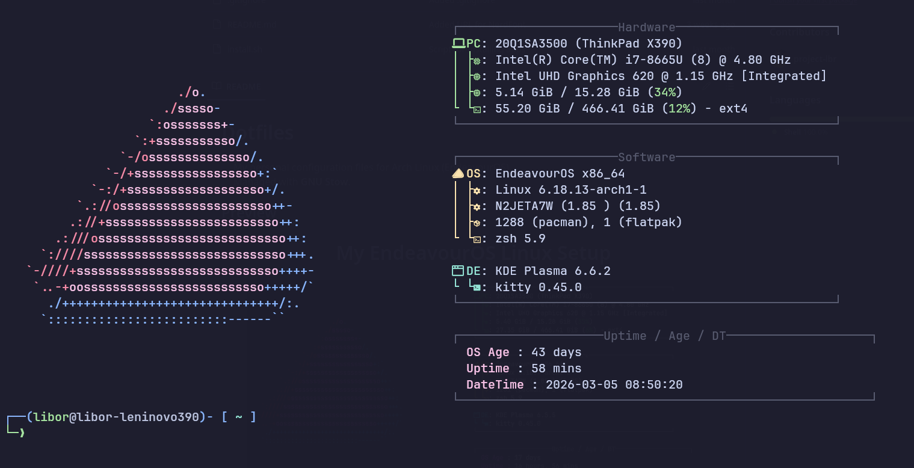

# ❄️ Dotfiles

> Personal configuration files for Arch-based Linux (EndeavourOS and CachyOS) running KDE Plasma.
> Themed with **Catppuccin Mocha** and managed with **GNU Stow**.

<p align="center">
  
</p>

---

## 📦 What's Inside

Each top-level folder is a Stow package that mirrors `$HOME`, e.g. `kitty/.config/kitty/kitty.conf` → `~/.config/kitty/kitty.conf`.

| Package | Tool | Notes |
|---------|------|-------|
| `fish` | [Fish](https://fishshell.com/) | Main shell: aliases, Starship + zoxide init, helper functions |
| `kitty` | [Kitty](https://sw.kovidgoyal.net/kitty/) | JetBrainsMono Nerd Font, 80% opacity with blur, tall/grid/fat layouts |
| `starship` | [Starship](https://starship.rs/) | Prompt (`~/.config/starship.toml`) |
| `fastfetch` | [Fastfetch](https://github.com/fastfetch-cli/fastfetch) | System info shown when a shell starts |
| `yazi` | [Yazi](https://yazi-rs.github.io/) | File manager with Catppuccin flavor and `wl-clipboard` plugin |
| `btop` | [Btop](https://github.com/aristocratos/btop) | Resource monitor with Catppuccin theme |
| `lazygit` | [Lazygit](https://github.com/jesseduffield/lazygit) | Terminal UI for git |
| `zshrc` | Zsh | Legacy oh-my-zsh config, not linked by the setup script |

Other folders:

* `installs/` – installation scripts (see below).
* `keybinds/Color-schemes.txt` – KDE Plasma appearance settings (colors, icons, cursors, window decorations).
* `assets/` – screenshots for this README.

---

## 🚀 Quick Start

Run the scripts as a normal user, not root – they ask for `sudo` when needed.

### 1. Install applications

Both scripts update the system, install `paru` if missing and install the full package list (browsers, media, office, dev tools and terminal utilities).

**Arch Linux / EndeavourOS** – builds `paru-bin` from the AUR, uses `timeshift` for snapshots:

```bash
bash -c "$(curl -fsSL https://raw.githubusercontent.com/project-lbr/dotfiles/main/installs/install_apps.sh)"
```

**CachyOS** – takes `paru`, `zen-browser` and `librewolf` from the CachyOS repos and uses `btrfs-assistant` instead of `timeshift`:

```bash
bash -c "$(curl -fsSL https://raw.githubusercontent.com/project-lbr/dotfiles/main/installs/install_apps_cachyos.sh)"
```

Each script only runs on its own distribution.

### 2. Link the dotfiles (all distributions)

```bash
bash -c "$(curl -fsSL https://raw.githubusercontent.com/project-lbr/dotfiles/main/installs/setup_dotfiles.sh)"
```

This script:

1. Clones the repo to `~/dotfiles` (or pulls if it already exists).
2. Installs `git`, `stow` and `fish` if they are missing.
3. Renames any existing configs that would conflict to `*.bak`.
4. Links `fastfetch lazygit yazi kitty btop starship fish` with `stow --restow`.
5. Sets Fish as the default shell.

---

## 🛠️ Manual Installation

```bash
sudo pacman -S git stow fish kitty starship fastfetch btop yazi lazygit zoxide eza fzf tmux ttf-jetbrains-mono-nerd
paru -S sesh-bin

git clone https://github.com/project-lbr/dotfiles.git ~/dotfiles
cd ~/dotfiles
stow fish kitty starship fastfetch yazi btop lazygit
```

Pick only the packages you want – each one can be stowed on its own.

---

## 🐟 Fish Highlights

| Command / Key | Action |
|---------------|--------|
| `ls`, `ll`, `tree` | `eza` with icons (and git status in `ll`) |
| `y` | Open Yazi; on exit the shell stays in the last visited directory |
| `s` | Pick a tmux session / project with `sesh` + `fzf` |
| `lg`, `ff`, `vi` | `lazygit`, `fastfetch`, `nvim` |
| `update` | `paru` |
| `dot` | `cd ~/dotfiles` |
| `Alt+S` | Toggle `sudo` at the start of the command line (or on the last command) |

`EDITOR` is set to `nvim`.

## ⌨️ Keybindings

**Kitty**

| Key | Action |
|-----|--------|
| `Ctrl+Shift+Arrows` | Move between windows |
| `Alt+Arrows` | Resize window |
| `Ctrl+Tab` / `Ctrl+Shift+Tab` | Next / previous tab |
| `Ctrl+Shift+T` | New tab and set its title |
| `Ctrl+Shift+E` | Rename tab |

**Yazi**

| Key | Action |
|-----|--------|
| `z` / `Z` | Jump to a directory with zoxide / fzf |
| `Ctrl+Y` | Copy selected files to the system clipboard |
| `+ ě š č ř ž ý á í` | Switch to tab 1–9 (Czech keyboard number row) |

---

## 🎨 Desktop Look (KDE Plasma)

* **Colors:** Catppuccin Mocha
* **Application & Plasma style:** Breeze
* **Window decorations:** Utterly-Round-Dark
* **Icons:** Kora
* **Cursors:** Catppuccin Mocha Light

External add-ons used in this setup:

* [AppGrid](https://appgrid.xarbit.dev/) – keyboard-driven application launcher used as the main pop-up panel.
* [Kara](https://github.com/dhruv8sh/kara) – KDE window decoration theme.
* [Plasma 6 Window Title Applet](https://github.com/dhruv8sh/plasma6-window-title-applet) – shows the active window title in the panel.
